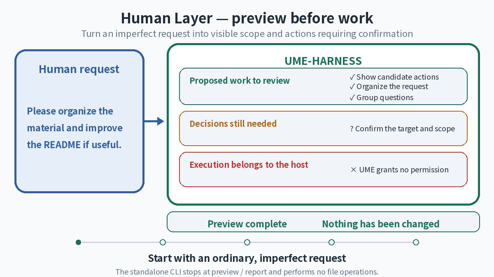
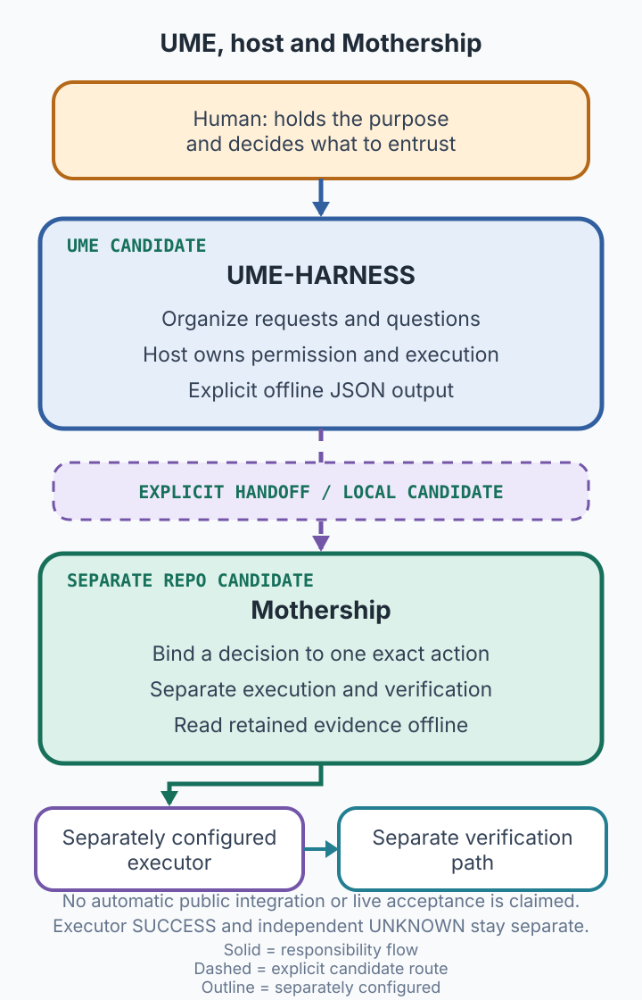
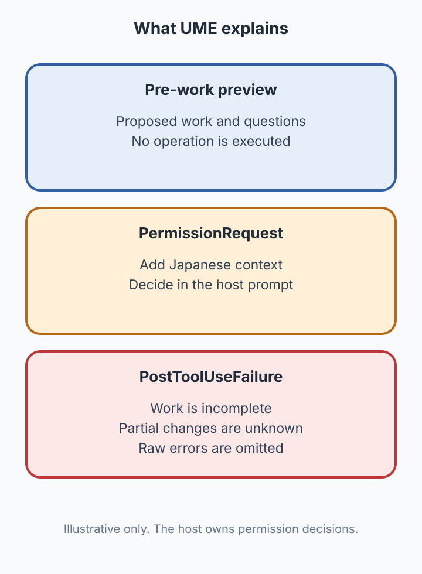

# UME-HARNESS

<p align="center">
  
</p>

> Unreleased engineering candidate: thin Japanese decision support.
> Main is an unreleased source candidate, different from tagged v0.1.7. Live installation is separate.

[日本語](README.md) · [Published releases](https://github.com/UMEBOSHIISAN/ume-harness/releases)

UME organizes vague requests into a pre-work preview and explains the decisions
still needed. The host owns execution, permissions, sandboxing, worktrees,
sessions, continuation and notifications. Japanese language alone is already
native-supported through language/output styles. UME retains clarification-impact
processing, conservative action meaning and deterministic explanations omitting
raw arguments, paths and error bodies. Comparative quality/usability is unmeasured.

<picture>
  <source media="(prefers-reduced-motion: reduce)" srcset="assets/readme/en/ume-harness-human-layer-poster.png">
  <source media="(max-width: 600px)" srcset="assets/readme/en/ume-harness-human-layer-poster.png">
  
</picture>

These are explanatory illustrations, not measured model quality or a native permission-dialog capture.

## Kept surfaces

- Non-executing preview: proposed work, necessary questions and suggested human decisions.
- Two presentation hooks: PermissionRequest and PostToolUseFailure; no permission
  decisions, host answers, tokens, execution or resume.
- Exact connection ownership, concurrent-update detection, explicit-prefix wrapper
  proof and immutable package-byte checks.

The candidate retires custom PreToolUse/managed/Lease enforcement, approval-token
storage, Stop state, shell execution policy and notifier/OSC routes.
`setup --managed` exits nonzero before settings changes. No OS sandbox, executor,
external authority or automatic Mothership invocation is provided by UME.

## Separate-prefix trial

Requires Git, Bash and Python 3.9+. Online interpretation needs an authenticated
compatible Claude CLI and network access; requests/context are sent to Claude.
For published versions follow their own tag instructions.

```bash
./scripts/install.sh --prefix "$HOME/.local/ume-harness-thin-candidate"
"$HOME/.local/ume-harness-thin-candidate/bin/ume-harness" \
  "Read this document and summarize it; do not change or post anything."
```

Existing prefixes are never replaced, including with --force. Install does not
connect hooks. Online preview checks native flags and requests safe mode, no tools,
all-tool denial, strict empty MCP, disabled skills/commands/browser and no transcript
persistence. Auth is preserved; administrator policy still applies. This is not a
zero-host-write or OS-isolation claim. The model uses sonnet alias without a fixed
version or quality guarantee. Invalid/incomplete output stops as a processing
error; valid null work type is accepted. Offline input avoids inference:

```bash
"$HOME/.local/ume-harness-thin-candidate/bin/ume-harness" --llm-output-file input.json
```

--json adds debug data after the report, not a pure versioned JSON API.
required_human_approvals names preview decision candidates, not issued authority.

### Explicit offline handoff

This unreleased candidate adds `--handoff-json`, a single
`ume.preview-handoff.v0` JSON document from the existing normalization path.
Both `--request` and `--llm-output-file` are required. It does not invoke a model,
collect an approval or execute an operation.
Inputs must be regular files of at most 128 KiB. Symlinks, including parent
directories, and special files such as FIFOs are rejected. Missing required
POSIX read semantics stop this opt-in path.

```bash
/path/to/candidate-prefix/bin/ume-harness --handoff-json \
  --request 'Inspect the isolated PR target' --llm-output-file input.json
```

Request and interpretation hashes correlate supplied inputs; they do not prove
prose/target agreement or grant authority. Combining it with `--json` is rejected.
A separate explicit Mothership entry owns exact-operation review, execution
reporting and persistence in the local integration candidate. Automatic public
integration, live canary and first-time human acceptance remain unverified.



The [Mothership guide pinned to PR #65's documentation revision](https://github.com/UMEBOSHIISAN/mothership/blob/dc0b0e465426b3b6e068729ad9e62524465c43f7/docs/thin-harness-handoff.md)
lists Harness `2da9a0a` with Mothership runtime `ccf53f5`.
The earlier four installed synthetic cases used Mothership `5812c25`;
a fresh installed E2E of the later input-read fix remains unverified.

## Connect and migrate

```bash
"$HOME/.local/ume-harness-thin-candidate/bin/ume-harness" setup --preview
"$HOME/.local/ume-harness-thin-candidate/bin/ume-harness" setup --yes
```

New entries are the two explanation hooks with native 3-second timeouts. Existing
owned timeouts/custom metadata remain unchanged and differences are reported.
Presentation failure does not add a denial. Use native notifications.

<details>
<summary>Three explanation surfaces</summary>



Actual text depends on the event. Raw arguments, paths, search terms and error bodies are omitted.

</details>

Keep the old prefix and trusted source until its connection is explicitly
removed. Deleting an old hook first can leave a blocking registration.

```bash
"/absolute/path/to/old-prefix/bin/ume-harness" setup --disconnect \
  --settings-path "/absolute/path/to/target-settings.json"
"$HOME/.local/ume-harness-thin-candidate/bin/ume-harness" setup --yes \
  --settings-path "/absolute/path/to/target-settings.json"
```

Normal setup holds on a same-root retired PreToolUse registration. Foreign prefixes
and third-party hooks stay untouched. A presentation inventory does not prove an
unrestricted host; other sources/hooks/native policy may apply. Do not force a
replacement or restore an entire stale settings backup.

```bash
"$HOME/.local/ume-harness-thin-candidate/bin/ume-harness" setup --disconnect
```

Only exact owned commands are modified. A stable nonblocking lock and pre/post-save
checks detect observed conflicts. No automatic retry, merge or restoration.
A race window with noncooperating writers remains; avoid concurrent settings edits.

## Diagnose and remove

```bash
python3 scripts/health_check.py \
  --installed-dir "$HOME/.local/ume-harness-thin-candidate/lib/ume-harness/v0.1.7" \
  --prefix "$HOME/.local/ume-harness-thin-candidate" \
  --settings-path "$HOME/.claude/settings.json"
./scripts/uninstall.sh --prefix "$HOME/.local/ume-harness-thin-candidate" --yes
```

Use trusted matching source. An explicit prefix requires its actual wrapper;
there is no fallback. Identity is not a signature. Inventory success does not
prove live reload/event firing. Uninstall preserves third-party/shared/unproven
files and user state, including retired Lease/token files. Use each old version's
retained trusted source for its uninstall.

## Evidence and source boundary

[Support Matrix](SUPPORT_MATRIX.md) separates f999276 physical observations from
changed-candidate tests. Synthetic host evidence is macOS arm64 / Claude2.1.309.
Interactive PermissionRequest, positive MCP execution, other platforms, general
semantic quality and beginner usability remain unverified. Native stdout handling
accepts truncated objects missing their final brace as plain text; onFailure:block
does not block every invalid output. These hooks are presentation-only.

```bash
python3 -m pytest -q -p no:cacheprovider tests ux/japanese-human-layer/tests
```

These READMEs and illustrations are release documentation, separate from installed
runtime byte identity. The [asset contract](assets/readme/source/asset-build.toml)
and [generator](assets/readme/source/generate_ume_harness_assets.py) retain the pinned font and Pillow inputs.

Only ume-harness-engineering is canonical. Public ume-harness is a generated
one-way mirror. [package_manifest.json](package_manifest.json) defines the closure;
[MANIFEST.md](MANIFEST.md) lists it. This candidate is unreleased; retained VERSION
metadata does not establish published-v0.1.7 compatibility.

Official [CLI](https://code.claude.com/docs/en/cli-reference),
[permissions](https://code.claude.com/docs/en/permissions),
[hooks](https://code.claude.com/docs/en/hooks),
[settings](https://code.claude.com/docs/en/settings) and
[output styles](https://code.claude.com/docs/en/output-styles).

## License

MIT: [LICENSE](LICENSE), [NOTICE](NOTICE). README asset font:
[SIL OFL 1.1](assets/readme/source/fonts/OFL-1.1.txt).
