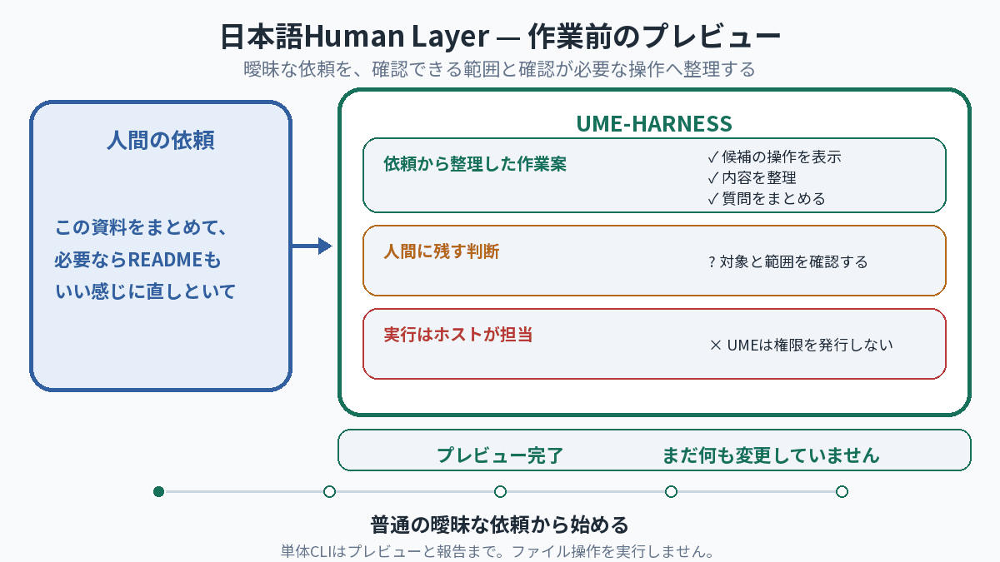
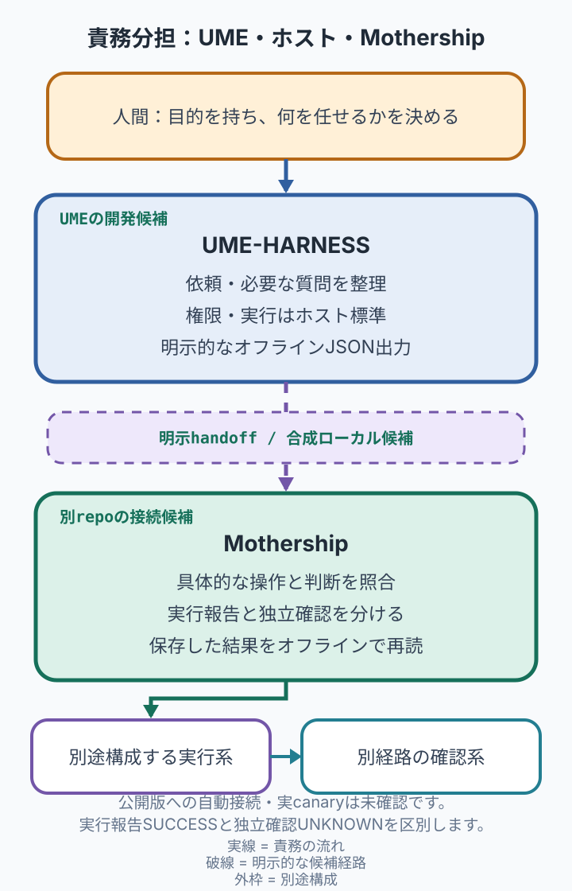
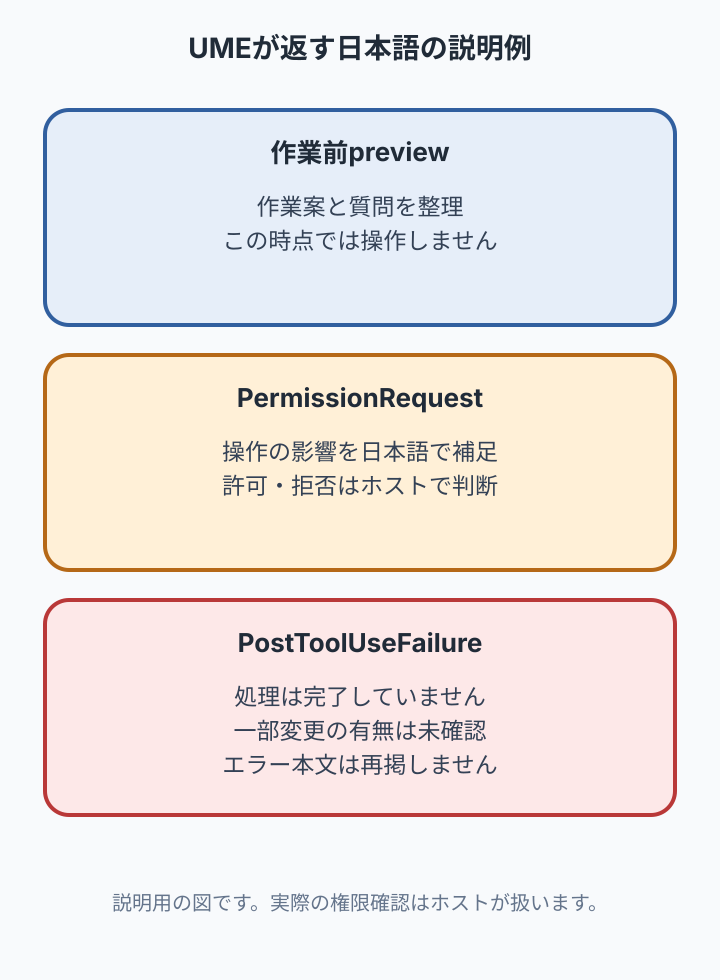

# UME-HARNESS

<p align="center">
  
</p>

> 開発候補：日本語の判断支援へ縮小しています。公開済みv0.1.7とは動作が異なります。
> mainは未リリースのソース候補です。通常設定への導入は別途行います。

[English](README.en.md) · [公開Releases](https://github.com/UMEBOSHIISAN/ume-harness/releases)

**必要な判断を、短く、正確な日本語で返す。**

UMEは曖昧な依頼を作業案へ整理し、実行結果や権限を取り違えないための小さな補助層です。
実行agent、権限管理、sandbox、worktree、セッション継続、通知にはホスト標準機能を使います。
日本語応答自体は公式の `language: "japanese"` やoutput styleでもできます。
残す価値は、質問の影響を整理する処理と、引数・パス・エラー本文を再掲しない決定論的な説明です。
ホスト単体に対する精度・使いやすさの優位性は未測定です。

<picture>
  <source media="(prefers-reduced-motion: reduce)" srcset="assets/readme/ja/ume-harness-human-layer-poster.png">
  <source media="(max-width: 600px)" srcset="assets/readme/ja/ume-harness-human-layer-poster.png">
  
</picture>

図は説明用です。モデルの回答精度や実機の権限画面を再現したものではありません。

## 残す機能

- **作業前preview**：作業案、必要な質問、実行前に人間が判断する操作を表示します。
  standalone CLIはファイル操作も外部操作も実行しません。自然文の分類は実行許可になりません。
- **日本語説明2hook**：`PermissionRequest` と `PostToolUseFailure` に説明を添えます。
  許可・拒否・回答・実行再開はホストが扱います。
- **接続・導入診断**：hook所有権の完全一致、設定更新の競合、導入物のbyte identityを確認します。
  設定ファイルの登録確認と、実セッションでの認識・発火は別です。

独自PreToolUse、managed/Lease、承認token、Stop/継続状態管理、shell/path実行判定、
terminal-notifierとOSC通知は配布しません。`setup --managed` は設定変更前に非0で終了します。
追加の実行制限、OS隔離、権限発行、Mothershipの自動呼出しは提供しません。
[Support Matrix](SUPPORT_MATRIX.md)に根拠と境界を記載しています。
GitHubの人気やXの投稿を品質や安全性の証明には使いません。

## 開発候補を専用prefixで試す

前提はGit、Bash、Python 3.9以降です。オンライン解析には認証済みの対応Claude CLIと
ネットワーク接続が必要で、依頼文とcontextをClaudeへ送ります。
公開版には[選択したtagの手順](https://github.com/UMEBOSHIISAN/ume-harness/releases)を使います。

```bash
./scripts/install.sh --prefix "$HOME/.local/ume-harness-thin-candidate"
"$HOME/.local/ume-harness-thin-candidate/bin/ume-harness" \
  "この資料を読んで要点をまとめて。変更や投稿はしないで" \
  --context "テスト用資料だけがある作業フォルダです。"
```

既存prefixへの上書きは `--force` でも拒否します。Package installだけでは接続しません。
オンライン解析は対応flagを確認し、safe mode、空tool、全tool deny、空strict MCP、
skills/commands・ブラウザ・session保存の無効化を指定します。認証は維持します。
管理者ポリシー由来の処理は残り、ホスト全体の無変更やOS隔離は保証しません。
モデルは `sonnet` aliasです。exact modelや解釈精度は固定・保証しません。
不完全な応答・前後の説明文・コードフェンスは処理失敗として停止し、依頼の書き直しを求めません。
`work_type: null` は受け付けます。オフライン確認はLLMを呼びません。

```bash
"$HOME/.local/ume-harness-thin-candidate/bin/ume-harness" --llm-output-file input.json
```

`--json` は説明に続くデバッグ情報で、純粋なversioned JSON APIではありません。
`required_human_approvals` はpreview上の判断候補で、承認tokenやホスト権限を発行しません。

### 明示的なオフライン引き継ぎ

この未リリース候補の `--handoff-json` は、既存のnormalize結果を
`ume.preview-handoff.v0` の単一JSONとして返します。`--request` と
`--llm-output-file` が必須で、モデル呼出し・承認入力・操作実行は行いません。
入力は128 KiB以内の通常ファイルに限定し、途中のディレクトリを含むsymlinkと
FIFOなどの特殊ファイルは拒否します。必要なPOSIXの読取機能がない環境では停止します。

```bash
/path/to/candidate-prefix/bin/ume-harness --handoff-json \
  --request '隔離したPRの対象を確認する' --llm-output-file input.json
```

依頼文・解釈入力のhashは同じ入力の照合用です。文章と操作対象の意味が一致する証明や
権限にはなりません。`--json` との併用は拒否します。Mothership側の明示的な入口が
具体的操作の判断・実行報告・結果保存を担当するローカル接続候補です。
公開版への自動接続、実canary、初見の人による受入は未実施です。



[Mothershipの導入ガイド（PR #65の文書revision固定）](https://github.com/UMEBOSHIISAN/mothership/blob/dc0b0e465426b3b6e068729ad9e62524465c43f7/docs/thin-harness-handoff.md)に、
Harness `2da9a0a`とMothership runtime `ccf53f5`の組み合わせを記載しています。
以前の4ケースの隔離E2EはMothership `5812c25`の結果です。
後続の入力読取り修正を含むruntimeの新しい導入E2Eは未確認です。

## 接続と旧managedからの移行

```bash
"$HOME/.local/ume-harness-thin-candidate/bin/ume-harness" setup --preview
"$HOME/.local/ume-harness-thin-candidate/bin/ume-harness" setup --yes
```

新規接続は説明2本のみで、他hookやnative権限は保持します。新規timeoutは3秒です。
既存のtimeout・独自metadataは変更せず差異を報告します。説明失敗を追加の拒否にはしません。
通知はホスト標準を使います。

<details>
<summary>日本語説明の3つの場面を見る</summary>



実際の表示はイベントに応じます。引数・パス・検索語・エラー本文は再掲しません。

</details>

**旧prefixと対応する信頼できるsourceを保持したまま、旧CLIで明示的に切断してから
新prefixへ接続してください。** 先に旧hookファイルを消すと、残った登録でblockされる場合があります。

```bash
"/absolute/path/to/old-prefix/bin/ume-harness" setup --disconnect \
  --settings-path "/absolute/path/to/target-settings.json"
"$HOME/.local/ume-harness-thin-candidate/bin/ume-harness" setup --yes \
  --settings-path "/absolute/path/to/target-settings.json"
```

同じpackage rootの旧PreToolUse登録を検出した通常setupは停止します。
別prefix・第三者hookは所有扱いせず、自動削除しません。診断が `presentation` でも、
他の設定元・hook・native権限が追加制限を持つ場合があります。
所有確認できない場合は、強制置換や古い設定バックアップの丸ごと復元で回避しません。

```bash
"$HOME/.local/ume-harness-thin-candidate/bin/ume-harness" setup --disconnect
```

設定更新は完全一致した所有commandだけが対象です。固定 `.ume-harness.lock` による
非blocking排他と保存前後検証を使い、競合時の自動再試行・マージ・復元はしません。
協調しない外部writerとの競合窓は残るため、同じ設定を同時編集しないでください。

## 診断・取り外し

```bash
python3 scripts/health_check.py \
  --installed-dir "$HOME/.local/ume-harness-thin-candidate/lib/ume-harness/v0.1.7" \
  --prefix "$HOME/.local/ume-harness-thin-candidate" \
  --settings-path "$HOME/.claude/settings.json"
./scripts/uninstall.sh --prefix "$HOME/.local/ume-harness-thin-candidate" --yes
```

信頼できるsourceから診断します。明示prefixは実際のwrapperを検査し、別CLIへfallbackしません。
byte identityは署名認証ではなく、信頼したcanonical/generated releaseの取得が前提です。
診断成功だけでは再読込・実発火を証明しません。取り外しも所有確認が必要で、第三者hookや
共有・未確認ファイルを削除せず、旧Lease/tokenを含む利用者stateを保持します。
旧版のuninstallには、その版を取得したsourceを使います。

## 検証範囲とsource

[Support Matrix](SUPPORT_MATRIX.md)は旧f999276の実機測定と縮小候補のテストを区別します。
実機測定はmacOS arm64 / Claude Code 2.1.309 / 合成データの限定条件です。
対話PermissionRequest、実MCP実行、他OS、日本語精度・導入容易性は未確認です。
Native hookは末尾の `}` がない出力などをplain textとして扱い、`onFailure: block` でも
不正出力をすべてblockしません。この候補の2hookは説明専用で、権限制御には使いません。

```bash
python3 -m pytest -q -p no:cacheprovider tests ux/japanese-human-layer/tests
```

このREADMEと画像は配布用説明資産で、実行runtimeの導入byte identityとは別です。
画像は既存の固定font・Pillowによる生成物です。
[生成条件](assets/readme/source/asset-build.toml)と[生成元](assets/readme/source/generate_ume_harness_assets.py)を同じrevisionで保持します。

`ume-harness-engineering` がcanonical sourceです。public `ume-harness` は一方向の生成mirrorで、
公開側の手修正・逆同期はサポートしません。[package_manifest.json](package_manifest.json)が
配布closure、[MANIFEST.md](MANIFEST.md)が表示一覧です。この候補は未リリースで、VERSION表記は
公開v0.1.7との互換性の保証になりません。

公式仕様：[CLI](https://code.claude.com/docs/en/cli-reference)、
[permissions](https://code.claude.com/docs/en/permissions)、[hooks](https://code.claude.com/docs/en/hooks)、
[settings](https://code.claude.com/docs/en/settings)、[output styles](https://code.claude.com/docs/en/output-styles)。

## License

コードはMIT。[LICENSE](LICENSE)・[NOTICE](NOTICE)を参照してください。
README asset用Noto Sans JPは[SIL OFL 1.1](assets/readme/source/fonts/OFL-1.1.txt)です。
